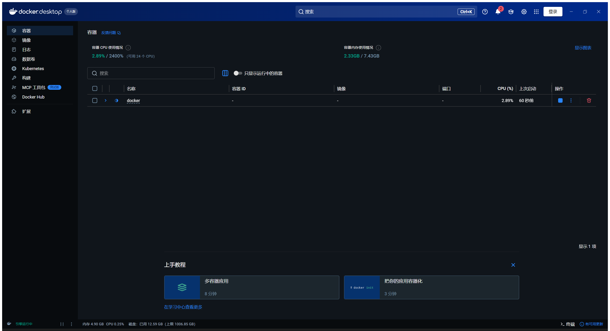

# Docker Desktop 中文界面

给 **Docker Desktop（Windows）** 的 Electron 界面加上中文。**不改动任何业务代码，随时可一键还原。**



> 官方没有中文语言包。本方案在 `app.asar` 内部注入一个翻译脚本，并关闭 Electron 的 ASAR 完整性校验——不关的话，被修改的包会被判定为损坏，界面进程启动即崩溃。

## 为什么需要它

Docker Desktop 的界面是一套打包在 `app.asar` 里的 Electron 应用（React + Chromium）：

- 没有 i18n 框架，文案是硬编码的英文
- 自带 **ASAR 完整性校验**，任何对 `app.asar` 的修改都会导致 `Integrity check failed for asar archive entry '<header>'` 并立即退出

所以"汉化"必须同时做两件事：改写包内容 **＋** 放行改写。

## 工作原理

```
┌─────────────────────────────────────────────┐
│  Docker Desktop.exe (Electron shell)        │
│    └─ app.asar                              │
│         ├─ index.html   ← 加一行 <script>   │
│         └─ assets/cn.js ← 翻译引擎          │
└─────────────────────────────────────────────┘
             ▲
             │ 注入
┌────────────┴────────────┐
│  inject.js              │
│   · 词典 DICT + 正则 RULES │
│   · MutationObserver 跟进动态内容 │
└─────────────────────────┘
```

| 文件 | 作用 |
|---|---|
| `inject.js` | 翻译引擎：遍历文本节点按词典替换，用 `MutationObserver` 持续跟进翻页、弹窗、表格刷新 |
| `patch-asar.js` | 把 `inject.js` 打包成 `cn.js` 塞进 `app.asar`，并在两个 `index.html` 的 `</head>` 前加 `<script src="/assets/cn.js">`，再重新打包 |
| `flip-fuse.js` | 关闭 Electron 的 `EnableEmbeddedAsarIntegrityValidation` fuse（备份原 exe） |
| `apply.mjs` | 通过 CDP 调试端口**热注入**（调试/开发用，日常不需要） |
| `shot.ps1` | 截取 Docker 窗口，用于核对翻译效果 |
| `还原英文.ps1` | 从备份恢复官方 `exe` 与 `app.asar`，回到英文原版 |

引擎（WSL 里的 dockerd）、容器、镜像、数据卷**完全不受影响**。

## 环境要求

- Windows 10/11
- Docker Desktop 4.x（验证于 **4.92.0**，Electron 43 / Chrome 150）
- Node.js ≥ 20

```sh
npm install @electron/asar @electron/fuses
```

## 使用

设 `$DD` 为安装目录（通常是 `%LOCALAPPDATA%\Programs\DockerDesktop`）。

```powershell
$DD = "$env:LOCALAPPDATA\Programs\DockerDesktop"
$RES = "$DD\frontend\resources"
$EXE = "$DD\frontend\Docker Desktop.exe"
$FE  = "$DD\frontend\Docker Desktop.exe"
```

### 1. 退出 Docker Desktop 并关闭完整性校验

> 容器会中断，重启后会按重启策略自动恢复。

```powershell
node flip-fuse.js "$FE" ".\backup"
```

### 2. 注入并重新打包

```powershell
node patch-asar.js "$RES\app.asar" "$RES\app-cn.asar" ".\inject.js"
```

### 3. 替换文件

```powershell
Move-Item "$RES\app.asar" "$RES\app.asar.orig"
Move-Item "$RES\app-cn.asar" "$RES\app.asar"
Remove-Item "$RES\app.asar.unpacked" -Recurse
Move-Item "$RES\app-cn.asar.unpacked" "$RES\app.asar.unpacked"
```

### 4. 启动 Docker Desktop

界面即为中文。

## Docker 更新之后

更新会**整体替换** `exe` 与 `app.asar`：

- 界面自动退回英文
- **不会崩溃**（官方包自身一致）
- 重新执行上面 1–4 步即可恢复中文

## 还原官方原版

```powershell
powershell -NoProfile -ExecutionPolicy Bypass -File .\还原英文.ps1
```

脚本会用备份覆盖 `exe` 与 `app.asar`，并重启应用。备份默认位于 `%LOCALAPPDATA%\DockerCN\backup\`。

## 安全权衡

关闭 `EnableEmbeddedAsarIntegrityValidation` 意味着：后续若再有程序篡改 `app.asar`，Docker 不会再拦截。

- 风险等级：低。利用它需要先能写入你的用户目录，那时攻击者能做的事已经很多。
- 不接受该权衡：随时运行 `还原英文.ps1` 回到官方原版。

## 翻译覆盖范围

**已翻译**：左侧导航、容器/镜像/数据卷列表、构建页、设置页主要栏目、常用按钮与提示、状态栏。

**仍是英文**：
- 容器日志正文（程序输出，翻译反而不利于排错）
- 错误详情、长段说明文字
- Docker 新增版本才有的界面
- `Docker Hub` 这类专有名词按惯例保留

想补词表：改 `inject.js` 里的 `DICT`（精确匹配）和 `RULES`（动态文本正则）。

```js
const DICT = {
  'Containers': '容器',
  'Only show running containers': '只显示运行中的容器',
  // ...
};
```

## 常见问题

**改完点图标没反应？**
`Integrity check failed` —— 没关 fuse。执行第 1 步。

**界面全白 / 启动即退？**
`app.asar` 打包过程出错。用 `还原英文.ps1` 回滚，再重试第 2–3 步。

**容器没了？**
没动容器。Docker 引擎重启后会按重启策略自动拉起；`docker ps -a` 可确认。

**翻译不生效？**
`app.asar.unpacked` 没同步替换，或 Docker 已更新覆盖了文件。

## 许可

[MIT](LICENSE)
